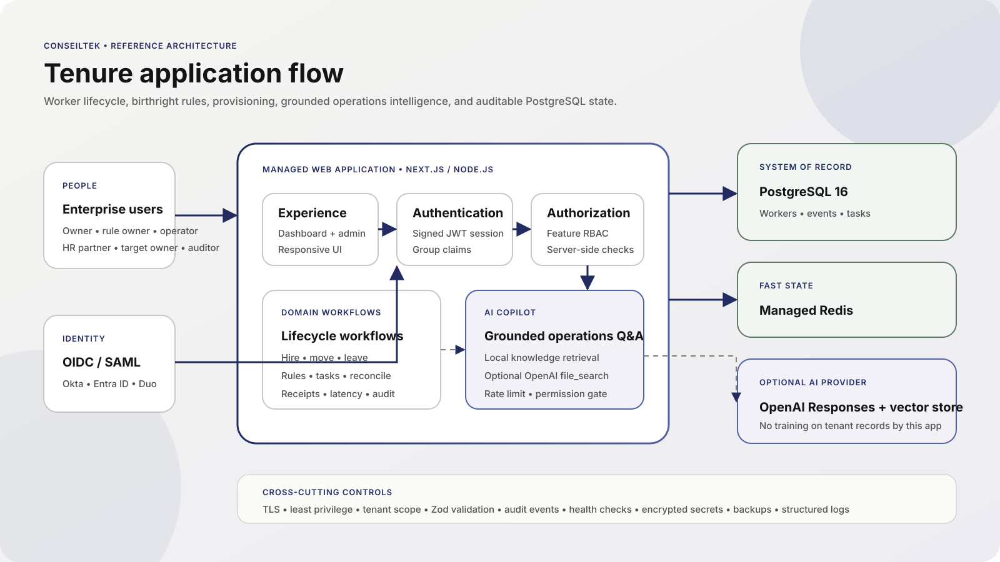

<p align="center"></p>
<h1 align="center">Tenure</h1>
<p align="center"><strong>Joiners, movers and leavers, provisioned on day one.</strong></p>

[](https://github.com/ConseilTek-Tektons/tenure/actions/workflows/ci.yml) [](https://github.com/ConseilTek-Tektons/tenure/actions/workflows/codeql.yml) [](LICENSE)

Tenure is a deployable identity-lifecycle reference application for effective-dated worker events, birthright rules, pre-hire staging, mover differences, terminations, contractors, provisioning, and reconciliation. See the [product rationale and honest parity matrix](https://conseiltek.com/techtons/tenure).



## Working scope

- PostgreSQL worker, lifecycle-event, versioned rule, provisioning-target, task, reconciliation, and audit models
- Server-authorized `/api/events` workflow and deterministic per-worker event ordering
- Feature RBAC for lifecycle administrators, rule owners, provisioning operators, HR partners, target owners, auditors, and viewers
- OIDC with step-up for rule publication, plus SAML through Keycloak and mappings for Okta, Entra ID, and Duo
- Grounded lifecycle Q&A for termination latency, rule impact, target drift, and failed tasks; no AI provisioning or rule publication
- Responsive ConseilTek interface aligned with the current website design

## Run locally

```bash
cp .env.example .env.local
docker compose up -d postgres redis keycloak
pnpm install --frozen-lockfile
pnpm db:migrate && pnpm db:seed
pnpm dev
```

## Deploy

- `infra/aws`: App Runner, Aurora PostgreSQL Serverless v2, ElastiCache Serverless, private storage, SQS, Secrets Manager, and CloudWatch
- `infra/azure`: App Service Web App for Containers, PostgreSQL Flexible Server, Azure Managed Redis, private Blob Storage, Storage Queue, Key Vault, and Monitor

Tenure requires server-side workflow execution and PostgreSQL. Static website resources are not used.

## Documentation

[Architecture](docs/ARCHITECTURE.md) · [Authentication](docs/AUTHENTICATION.md) · [RBAC](docs/RBAC.md) · [AI](docs/AI.md) · [Security](docs/SECURITY.md) · [Operations](docs/OPERATIONS.md)

Tenure is designed, built, and maintained by [ConseilTek](https://conseiltek.com) under Apache 2.0. Contact [support@conseiltek.com](mailto:support@conseiltek.com).
