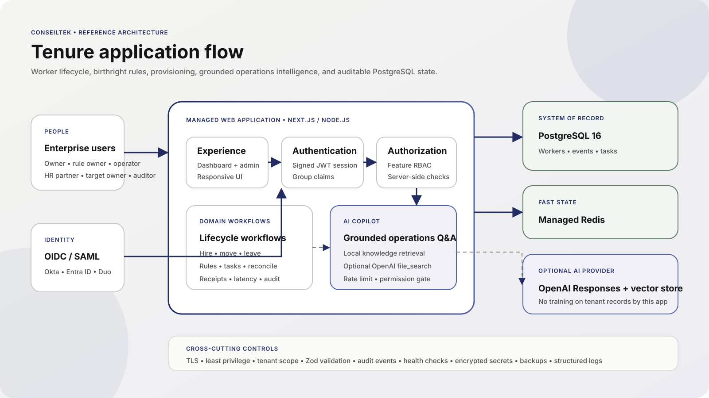
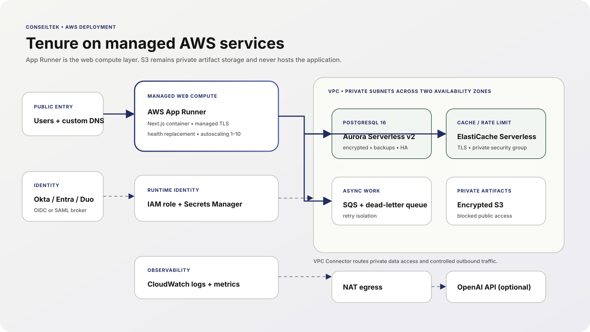
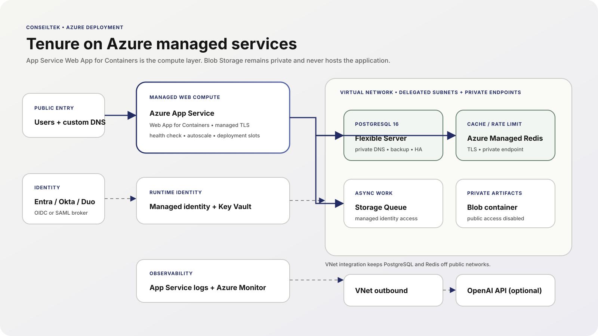

# Tenure architecture

Tenure is a server-rendered identity-lifecycle application with authenticated APIs, feature RBAC, PostgreSQL 16, optional Redis, deterministic per-worker ordering, versioned rules, provisioning tasks, reconciliation, and grounded assistance.

HR events are deduplicated, validated, and ordered by worker and effective time. Rules evaluate intended access in dry-run before publication. Provisioning tasks use idempotency keys and require durable target receipts. Reconciliation compares intended with actual state and produces a reviewable repair plan. Termination latency is measured from authoritative event receipt through the final verified disable.

AWS uses App Runner, Aurora PostgreSQL Serverless v2, ElastiCache Serverless, queues, private storage, Secrets Manager, and CloudWatch. Azure uses App Service Web App for Containers, PostgreSQL Flexible Server, Azure Managed Redis, private Blob Storage, Storage Queue, Key Vault, and Monitor.

The application requires managed server compute and does not use static website resources.
